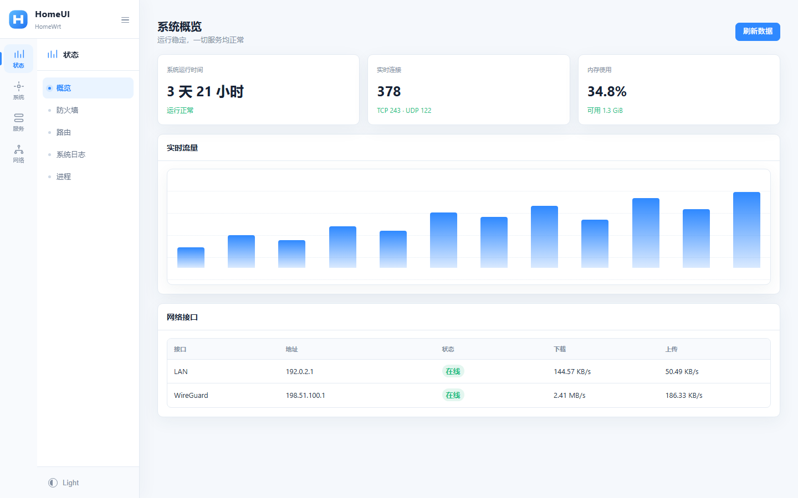
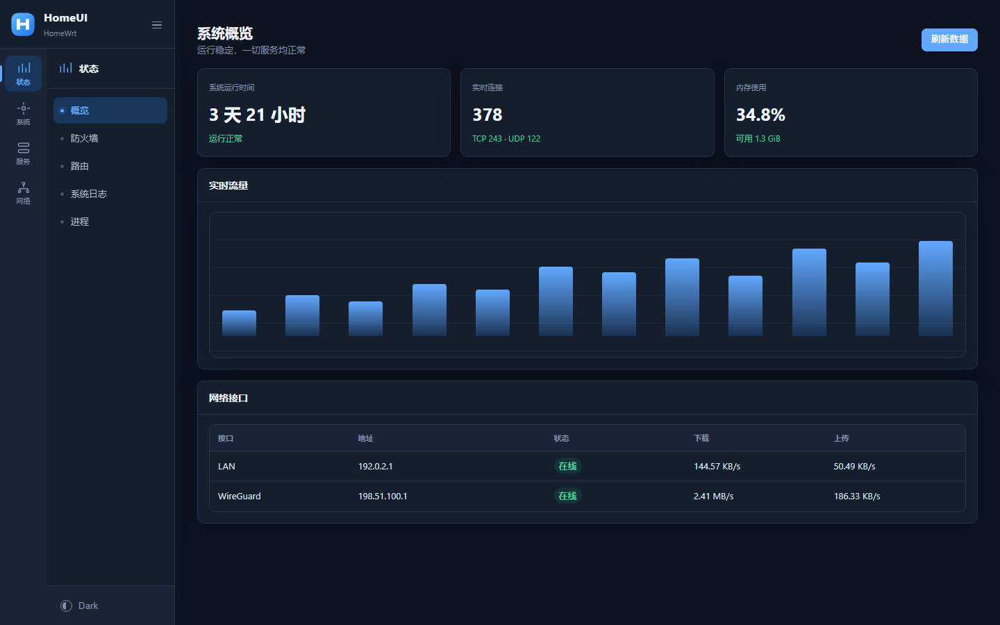
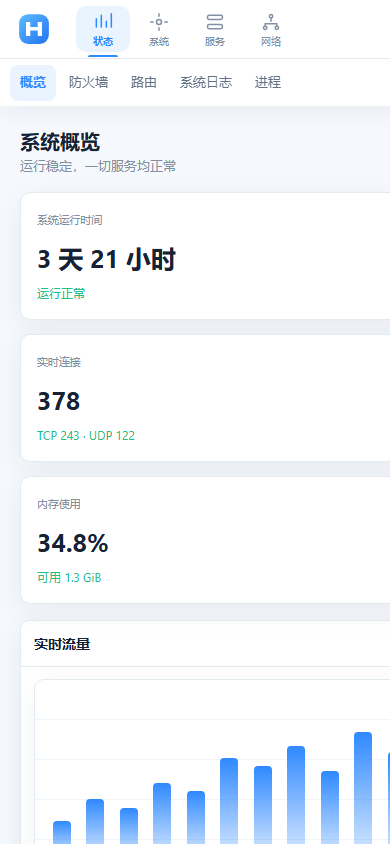

# HomeUI 设计说明

HomeUI 是针对本项目 ImmortalWrt 25.12 固件设计的 UCode LuCI 主题。其信息
密度与导航结构参考现代路由器后台，但没有复制第三方商标、图标或源代码。







## 设计语言

- 主色：`#2f89ff`，用于当前导航、主要按钮和焦点状态。
- 页面背景：`#f5f8fc`；内容表面：`#ffffff`。
- 双层导航：68 px 图标栏和 184 px 分组菜单，可折叠为单图标栏。
- 卡片圆角：10 px；控件圆角：7 px；边框：`#e3eaf2`。
- 字体优先使用系统字体，中文使用苹方或微软雅黑。
- 深色模式默认跟随系统，也可在侧栏底部循环切换。

## 响应式布局

桌面端显示双层固定侧栏。宽度不超过 900 px 时，一级菜单和二级菜单分别
变成顶部两行可横向滚动的导航，避免抽屉菜单遮挡表单。

## 安装与回退

固件构建后，在“系统 → 系统 → 语言和界面”中选择 `HomeUI`。

GitHub Actions 的 Artifact 和 Release 还会包含可独立安装的
`luci-theme-homeui*.apk`。把文件上传到路由器的 `/tmp` 后执行：

```sh
apk add --allow-untrusted /tmp/luci-theme-homeui*.apk
uci set luci.themes.HomeUI='/luci-static/homeui'
uci set luci.main.mediaurlbase='/luci-static/homeui'
uci commit luci
rm -rf /tmp/luci-indexcache /tmp/luci-modulecache
/etc/init.d/uhttpd restart
```

如果第三方插件页面出现严重布局问题，可通过 SSH 回退：

```sh
uci set luci.main.mediaurlbase='/luci-static/bootstrap'
uci commit luci
rm -rf /tmp/luci-indexcache /tmp/luci-modulecache
/etc/init.d/uhttpd restart
```
